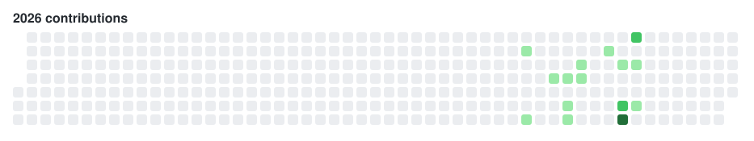

<picture>
  
</picture>

---

## 🚀 Featured projects

<b>🏆 FairBench</b>, ESG finance × quantum (2026)

 

A benchmark that separates an ESG fund manager's skill from the cost of ESG/SFDR 2.0 portfolio constraints, using random-portfolio benchmarking with quantum constrained sampling.

- 🥉 **3rd place**, Hanken Quantum × Finance Hackathon (Ultrahack, Helsinki)
- Led the finance and business side of the team (Faaahnance)
- 🔗 [Repository](https://github.com/lalashutosh/FairBench)

<b>🛰️ Space-debris capture</b>, computer vision (solo, 2024)

 

A computer-vision system that finds a piece of space debris and sends a servo-aligned net after it.

- Presented personally to the Prime Minister of India at Pariksha Pe Charcha 2024

<b>🌾 Terra Mitra</b>, AI-enabled farming device (2023)

 

Co-founded and designed an AI-enabled farming device.

- Top 24 among 13,000+ projects at the NEP celebrations, Pragati Maidan
- Featured on the Global Climate Clock with NITI Aayog

<b>🕶️ Smart glasses</b>, for the hearing-impaired (2025)

 

Low-cost smart glasses built on a Raspberry Pi for under ₹4,000.

- Led a six-member team to the semifinals

<b>📈 MarksMaxxing</b>, board-paper analysis (2026)

 

Co-founded a web app that reads past board papers to surface what recurs.

- Read 1,000+ pages of board papers
- Built the web app in under 10 days

<b>🧠 CtrlAltDelete</b>, one-command pipeline (Python)

 

A one-command pipeline that runs detection, triage, inventory and export.

🔗 [Repository](https://github.com/abhinavchutani/CtrlAltDelete)

<b>🕹️ Engram</b>, corporate decision search

 

A search tool for finding past corporate decisions.

## 🎯 Leadership

<b>Leading people and events</b>

 

- Head Boy, school-wide
- Led Scifest and Melange for 2,000+ attendees
- Scaled ACON into a regional symposium of 500+ students
- Public speaking at assemblies and national platforms, with MUN awards at Concordia (high commendation), SHISMUN (special mention) and BBI

## 📊 2026 contributions

  <picture>
    <source media="(prefers-color-scheme: dark)" srcset="https://raw.githubusercontent.com/abhinavchutani/abhinavchutani/main/assets/contrib-2026-dark.svg" />
    
  </picture>

---

### 👉 [abhinavchutani.github.io](https://abhinavchutani.github.io) 👈

